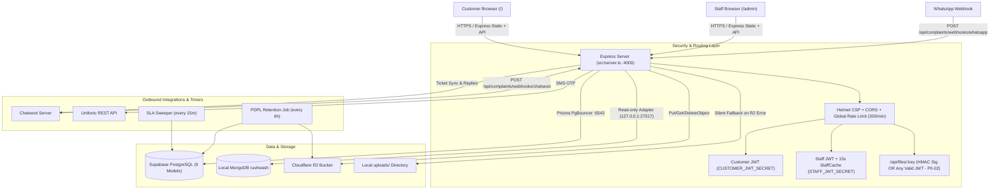

# 01 — Architecture Overview & Code Quality Audit

**Audit Timestamp:** `2026-11-25 16:30:00 AST (Asia/Riyadh)`  
**Target Application:** RUSH Car Wash (`رش واش` — Al Kharj Single Branch) Customer Care & Complaints Portal  
**Workspace Path:** `c:\Users\Rush\Documents\antigravity\gallant-volta\Customer Portal`  
**Audit Scope:** Complete static inspection of `src/` (18 files), `prisma/` (9 files), `public/` (2 SPAs), `tests/` (3 pre-existing + 2 audit harness files), `package.json`, `.env.example`, and `.env` key-presence metadata.

---

## 1. Technology Stack Inventory

| Layer | Technology | Version | Evidence |
|---|---|---|---|
| **Backend Runtime** | Node.js + TypeScript | `typescript@^5.7.3`, `tsx@^4.19.3` | `package.json`, `tsconfig.json` (`target: ES2022`, `strict: true`) |
| **Web Framework** | Express.js | `express@^4.21.2` | `src/server.ts` |
| **Security Middleware** | Helmet, CORS, express-rate-limit | `helmet@^8.3.0`, `cors@^2.8.5`, `express-rate-limit@^8.7.5` | `src/server.ts`, `src/middleware/security.ts` |
| **Validation** | Zod | `zod@^3.24.2` | `src/routes/*.ts` |
| **Auth & Crypto** | JWT + bcryptjs + Node `crypto` | `jsonwebtoken@^9.0.2`, `bcryptjs@^3.0.3` | `src/config/env.ts`, `src/utils/crypto.ts` |
| **Primary Database** | Supabase PostgreSQL (PgBouncer `:6543` + Direct `:5432`) | Prisma `5.22.0` (`@prisma/client@^5.22.0`) | `prisma/schema.prisma`, `.env.example` |
| **Secondary Read Adapter** | Local MongoDB (`rushwash`) | `mongodb@^7.9.1` | `src/services/mongo.ts` (`ENABLE_LOCAL_MONGO`) |
| **Frontend UI** | Single-file HTML5 + Vanilla JS + Tailwind Play CDN + Lucide + Chart.js | Tailwind `3.4.17`, Lucide `0.460.0`, Chart.js `4.4.1` | `public/rush_wash_customer_care.html`, `public/rush_admin_operations_console.html` |
| **File Storage** | Cloudflare R2 (S3-compatible) + local `uploads/` fallback | `@aws-sdk/client-s3@^3.758.0`, `multer@^2.5.0` | `src/services/storage.ts`, `src/routes/upload.ts` |
| **SMS OTP Gateway** | Unifonic Bulk SMS REST API | HTTP `fetch` | `src/services/unifonic.ts` |
| **WhatsApp & CRM Sync** | Chatwoot v1 REST API + Webhooks | HTTP `fetch` | `src/services/chatwoot.ts`, `src/routes/complaints.ts` |
| **Testing** | Vitest + Supertest | `vitest@^2.1.8`, `supertest@^7.0.0` | `tests/*.test.ts` |
| **Background Jobs** | In-process `setInterval` timers | Native Node timers | `src/services/slaSweeper.ts`, `src/services/retention.ts` |
| **Deployment / CI** | Local `.bat` launcher (`npm run build && npm start`); no Dockerfile/CI/PM2 in repo | — | `Run_Customer_Portal.bat` |

---

## 2. System Architecture Diagram

---

## 3. Application Entry Points & Route Boundaries

- **Web Entry Points** (`src/server.ts:128-139`):
  - `GET /` — Public Customer Care Portal (`public/rush_wash_customer_care.html`, `Cache-Control: no-store`).
  - `GET /admin` — Public Admin & Operations Console HTML shell (`public/rush_admin_operations_console.html`, `Cache-Control: no-store`; data gated behind `/api/admin/auth/login`).
  - `GET /api/health` — Public PostgreSQL `SELECT 1` liveness probe.
- **API Routers** (`src/server.ts:142-146`):
  - `/api/auth` (`src/routes/auth.ts`) — Public OTP request & verify endpoints.
  - `/api/customer` (`src/routes/customer.ts`) — Customer JWT authenticated wash/order history.
  - `/api/complaints` (`src/routes/complaints.ts`) — Mixed: unauthenticated `/track` (**P0-01**), HMAC/token webhooks, and Customer JWT complaint CRUD/damage/CSAT.
  - `/api/upload` (`src/routes/upload.ts`) — Customer or Staff JWT multipart upload (`15 MB` cap, magic-byte sniffed).
  - `/api/admin` (`src/routes/admin.ts`) — Staff authentication, dashboard KPIs, claims triage, damage approvals, finance disbursement, CSV export, staff RBAC, and owner PDPL endpoints.
- **File Proxy** (`src/server.ts:93-118`):
  - `GET /api/files/:key(*)` — Serves R2 or local `uploads/` files via HMAC signed URL (`?exp=...&sig=...`) or any Customer/Staff JWT (**P0-02**, plus missing `signatures` prefix **P1-01**).

---

## 4. Security Boundaries & Trust Zones

1. **Key Derivation Boundary (`src/config/env.ts:13-19`)**: Derives four domain-separated HMAC keys (`CUSTOMER_JWT_SECRET`, `STAFF_JWT_SECRET`, `OTP_PEPPER`, `FILE_URL_SECRET`) from `JWT_SECRET` (min 32 chars). Refuses startup if `JWT_SECRET` or `FIELD_ENCRYPTION_KEY` is missing/weak in non-test environments.
2. **Broken Boundary — Unverified `/track` Elevation (`P0-01`)**: `POST /api/complaints/track` (`src/routes/complaints.ts:248-307`) crosses from unauthenticated lookup to an authenticated `trackToken` (`scope: "track"`) using only sequential Ticket ID + phone number without OTP.
3. **Broken Boundary — Global File Proxy (`P0-02`)**: `hasValidFileAuth()` (`src/server.ts:73-91`) validates JWT signature only, without verifying ticket ownership or staff `active` status.
4. **PostgreSQL vs. Supabase PostgREST (`prisma/enable_rls.sql`)**: RLS is enabled and `anon`/`authenticated` grants are revoked; Express connects as the privileged Prisma pooler role bypassing RLS.
5. **Local MongoDB Isolation (`src/services/mongo.ts:4-21`)**: Strictly read-only queries against `MONGODB_URI` (`127.0.0.1:27017/rushwash`) gated behind `ENABLE_LOCAL_MONGO === "true"`.

---

## 5. Code Quality & Maintainability Review

- **Confirmed Bugs & Duplicated Constants**:
  - `FILE_KEY` / `VALID_STORAGE_KEY` regex is duplicated in **four places** (`src/server.ts:72`, `src/utils/crypto.ts:5`, `src/services/storage.ts:112`, `src/utils/normalize.ts:27`). Only `src/routes/upload.ts:10` includes `"signatures"`, causing **100% failure (404)** when serving or deleting digital signatures (**P1-01**).
  - `taxDetails` fallback object is duplicated verbatim in `src/routes/complaints.ts:295-302` and `330-337`.
- **Stale Documentation & Artifacts**:
  - `README.md:104-105` references non-existent `src/lib/prisma.ts` and `src/lib/r2.ts` instead of `src/services/storage.ts` and `src/server.ts`.
  - Root directory contains `RushComplaitn_updated.zip` (96,472 bytes) which should not be deployed to production.
- **Unguarded Destructive Scripts (`P0-03`)**:
  - `prisma/setup_e2e_clean.ts` and `prisma/seed_mock_e2e.ts` omit `assertSafeToRunDestructive()` (`prisma/guard.ts`) and carry hardcoded fallback `E2E_STAFF_PASSWORD = "E2e-Rush!2026-Sec#9"` while upserting `BUSINESS_OWNER` and `ADMIN` users.
- **Unbounded Queries & Missing Transactions**:
  - Zero `prisma.$transaction()` blocks across financial/retention workflows; `/api/admin/dashboard` and `/api/admin/claims` fetch unbounded complaint lists into Node memory.
